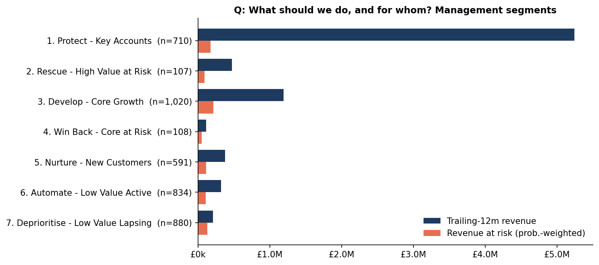

# E-Commerce Customer Intelligence & LTV Engine

An end-to-end customer analytics project, structured as if commissioned by an online retailer's
management team. It turns two years of raw transaction data into reconciled KPIs, validated
customer-value and churn-risk models, eight action-ready customer segments, a revenue-at-risk
estimate and a management action plan.

> **Headline:** revenue grew 1.7%, but sales to identifiable customers fell 2.5% while guest sales
> rose 32%. Only 64% of customers returned year-on-year (net revenue retention 81%).
> **£887k (11%) of next year's revenue is at risk.** 107 high-value accounts (£472k/yr) need
> intervention now. → [Executive report](reports/executive_report.md)



---

## Business questions answered
| # | Question | Answer (calculated) |
|---|---|---|
| 1 | How much of the business can customer analytics see? | 84.9% of gross sales; 15.1% has no Customer ID |
| 2 | Is growth healthy? | No — identified-customer sales −2.5%, guest sales +32% (FY Dec–Nov) |
| 3 | Are we keeping customers? | 63.9% customer retention; 80.8% net revenue retention |
| 4 | How concentrated is revenue? | Top 1% of customers = 31% of revenue; top 20% = 77% |
| 5 | When do customers drop off? | Only 21% of new customers order in their second month |
| 6 | What is each customer worth? | 12-month revenue CLV per customer (ranking validated; £ total treated as a range) |
| 7 | Who will stop buying? | Churn model, CV AUC 0.785, calibrated to ±3pp |
| 8 | How much revenue is at risk? | £887k of £7.94M trailing-12m revenue |
| 9 | What should we do? | 8 management segments with actions, owners, KPIs and an ROI scenario model |

## What makes this more than a tutorial project
* **Data traps found and fixed:** the two source sheets overlap (1,088 invoices duplicated);
  orders up to 80,995 units were keyed and cancelled minutes later (matched and excluded from
  order counts, not just netted); non-merchandise codes separated (and `DCGS*` codes verified
  as real products, not excluded blindly).
* **Reconciliation:** a revenue bridge from ledger to analytics base that closes to **£0.00**.
* **Honest model validation:** CLV tested out-of-sample *and* on a 12-month backtest. Counts are
  accurate (−2%) but £ level is not (−15% / +34%), so CLV is used for ranking. BG/NBD P(alive)
  was found to rank churn *worse than random* and is therefore not used for risk.
* **Seasonality-aware churn design:** 365-day label (180 days mislabels seasonal buyers),
  trained on a cutoff seasonally matched to the scoring date, calibration checked because
  probabilities are multiplied by revenue.
* **Business logic, not just scores:** the at-risk trigger scales with account value, the
  call list is ranked by exposure, and a 30-day minimum-silence rule prevents false alarms after
  the Christmas peak.
* **SQL ↔ Python parity tests**, a no-leakage test, and 9 further data/logic tests.

## Repository map
| Path | Contents |
|---|---|
| `pipeline.py` | One command rebuilds everything |
| `src/cie/` | Production code: ingest → clean → audit → warehouse → rfm → clv → churn → segments → eda → exports |
| `sql/` | 8 SQL scripts (staging, star schema, KPIs, RFM, cohorts, churn rules, concentration, reconciliation) — [SQL README](sql/README.md) |
| `notebooks/` | 6 narrative notebooks, each ending with *"What should management do differently?"* |
| `reports/executive_report.md` | Management report |
| `reports/figures/`, `reports/tables/` | 12 charts; every result table as CSV |
| `powerbi/` | DAX measure library + model tables (`powerbi/data/`) |
| `excel/retention_investment_model.xlsx` | Scenario model: margin, save rates, contact costs → ROI, break-even |
| `docs/` | [Business problem & stakeholders](docs/01_business_problem_and_stakeholders.md) · [KPI definitions](docs/02_kpi_definitions.md) · [Architecture & data model](docs/03_architecture_and_data_model.md) · [Dashboard spec](docs/04_dashboard_spec.md) · [Feasibility](docs/05_feasibility_can_and_cannot.md) · [Assumptions log](docs/assumptions_log.md) · [Interview prep](docs/06_interview_prep.md) |
| `tests/` | `pytest` data & logic tests |

## How to run
```bash
pip install -r requirements.txt
# Place the dataset at data/raw/online_retail_II.xlsx
#   (UCI Machine Learning Repository: "Online Retail II")
python pipeline.py                     # first run ~5–10 min (Excel read), then seconds
pytest -q                              # 11 tests
python notebooks/_build_notebooks.py   # rebuild & execute notebooks
```
Resume from any step: `python pipeline.py --from churn`. All parameters and their rationale
are in `src/cie/config.py`; random seeds are fixed.

## Method summary
| Step | Approach | Key decision |
|---|---|---|
| Cleaning | Rule-based, flag-don't-delete | Match reversals instead of dropping negatives |
| Data model | Kimball star schema in DuckDB | Invoice grain for orders; customer-day for CLV |
| RFM | R, M quintiles; F business bins | 27% single-order customers make F quintiles meaningless |
| Cohorts | First-order month, monthly activity | Exclude left-censored Dec-2009 cohort |
| CLV | BG/NBD + Gamma-Gamma (from the papers, SciPy) | 12-month revenue horizon; validated vs naive |
| Churn | Logistic regression vs GBM vs 2 baselines | 365-day label; seasonally matched training |
| Revenue at risk | Trailing-12m revenue × P(churn) | Exposure measure; excludes shrinkage |
| Segments | Value (trailing revenue) × risk | Value-scaled trigger; CLV not used for tiering |

## Limitations (see [feasibility](docs/05_feasibility_can_and_cannot.md))
No cost/margin data (CLV is revenue), no marketing spend or channel (no CAC/ROI), no customer
attributes beyond country, 15% of sales unattributable, only one year-on-year observation, and
no campaign data (so no causal claims). The Power BI `.pbix` must be built in Power BI Desktop
from the provided specification, DAX and data.

## Skills demonstrated by role
| Role | Evidence in this repo |
|---|---|
| Data Analyst | Data audit, cleaning rules, SQL (window functions, cohorts), EDA, KPI dictionary, dashboard spec |
| Business Analyst | Stakeholder map, business questions → analyses, feasibility statement, action playbook |
| Business / Management Analyst | Executive report, prioritised decisions with owners and success measures, segment strategy |
| Finance / Commercial Analyst | Revenue bridge, FY decomposition, NRR, concentration risk, revenue at risk, ROI and break-even scenario model |

*Data: Online Retail II, UCI Machine Learning Repository (Chen, 2019). Currency and business
description per the dataset documentation.*
