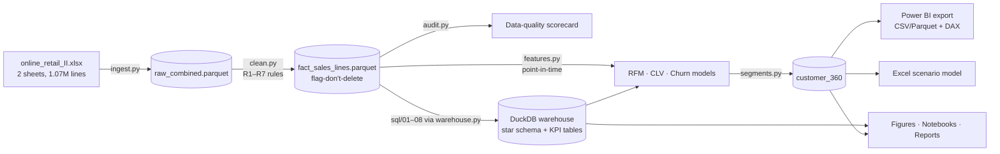

# 03 · Architecture & Analytical Data Model

## Pipeline architecture



Design principles:
1. **Flag, don't delete.** Only provable duplicates are removed; every other line survives with
   `line_type` / `item_type` / `is_reversed` flags so finance can reconcile.
2. **One definition per metric.** SQL owns KPIs; Python owns models; Power BI only aggregates.
   Tests assert SQL and Python agree.
3. **Point-in-time correctness.** All model features take an explicit `cutoff`; a test proves
   removing future data does not change features (no leakage).
4. **Every parameter in one place** (`src/cie/config.py`) with the reason for its value.

## Folder structure

```
ecommerce-customer-intelligence/
├── README.md                     project overview & how to run
├── pipeline.py                   one-command reproducible build
├── requirements.txt
├── data/
│   ├── raw/                      place online_retail_II.xlsx here (git-ignored)
│   ├── interim/                  raw parquet cache (generated)
│   └── processed/                clean facts, model outputs, warehouse.duckdb (generated)
├── src/cie/
│   ├── config.py                 paths + every analytical parameter, with rationale
│   ├── ingest.py                 Excel → parquet, no cleaning
│   ├── clean.py                  cleaning rules R1–R7, reversal matching
│   ├── audit.py                  data-quality scorecard (rows AND £)
│   ├── warehouse.py              runs sql/0*.sql in DuckDB, exports tables
│   ├── features.py               point-in-time customer features
│   ├── rfm.py                    RFM (mirror of SQL)
│   ├── clv.py                    BG/NBD + Gamma-Gamma, holdout + 12m backtest
│   ├── churn.py                  churn model, baselines, calibration, scoring
│   ├── segments.py               value × risk, revenue at risk, playbook
│   ├── eda.py                    all report figures
│   ├── export_powerbi.py         star schema for Power BI
│   └── excel_pack.py             Excel scenario model
├── sql/                          01_staging … 08_reconciliation (+ README)
├── notebooks/                    01–06 narrative notebooks (+ builder script)
├── powerbi/
│   ├── dax_measures.dax
│   └── data/                     model tables for Power BI
├── excel/retention_investment_model.xlsx
├── reports/
│   ├── executive_report.md
│   ├── figures/                  12 charts
│   └── tables/                   every result table as CSV
├── docs/                         business framing, KPIs, model, dashboard spec,
│                                 feasibility, assumptions log, interview prep
└── tests/test_pipeline.py        11 data & logic tests
```

## Star schema (Power BI / warehouse)

```mermaid
erDiagram
    dim_date ||--o{ fact_orders : "order_date"
    dim_customer ||--o{ fact_orders : "customer_id"
    dim_country ||--o{ fact_orders : "country"
    dim_date ||--o{ fact_sales_lines : "invoice_date"
    dim_product ||--o{ fact_sales_lines : "stock_code"
    dim_customer ||--o{ fact_sales_lines : "customer_id"
    seg_playbook ||--o{ dim_customer : "management_segment"

    fact_orders { string invoice PK; string customer_id FK; date order_date FK; string order_type; float order_value; int units }
    fact_sales_lines { int line_id PK; string invoice; string stock_code FK; float revenue; string line_type; bool is_reversed }
    dim_customer { string customer_id PK; string cohort_month; float clv_12m; float churn_prob_12m; float revenue_at_risk; string management_segment }
    dim_product { string stock_code PK; string product_name; string item_type }
    dim_date { date date_key PK; string fiscal_year; bool is_partial_month }
    dim_country { string country PK; string region }
    seg_playbook { string management_segment PK; string action; string success_kpi }
```

### Grain decisions
| Table | Grain | Why this grain |
|---|---|---|
| `fact_sales_lines` | invoice line | product mix, returns, reconciliation |
| `fact_orders` | invoice | AOV, frequency, cadence — customers think in orders, not lines |
| `dim_customer` | identified customer | holds all scores ("customer 360"); guests have no row by necessity |
| purchase occasion (models only) | customer-day | several invoices on one day = one buying decision (standard for CLV) |

### Why DuckDB
Zero-install analytical SQL engine that reads Parquet directly, so the whole warehouse is
reproducible on a laptop. SQL is written ANSI-leaning; porting notes are in `sql/README.md`.
